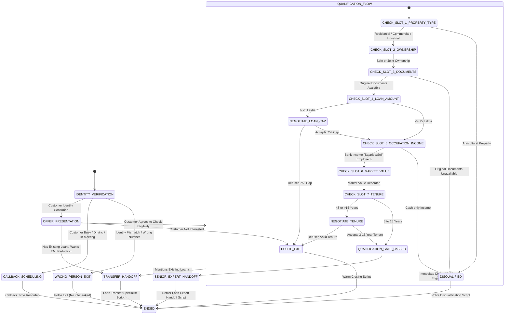

# STATE MACHINE & BUSINESS LOGIC ARCHITECTURE

## 1. Overview
The Home Credit Loan Against Property (LAP) Voice Agent operates as an Event-Driven Finite State Machine (FSM) integrated with a dynamic slot-filling entity extractor.

---

## 2. State Transition Table

| Current State | Trigger / Event | Next State | Spoken Action / System Side Effect |
|---|---|---|---|
| `INIT` | Call Connected | `IDENTITY_VERIFICATION` | "Hello, am I speaking with {{customer_name}}?" |
| `IDENTITY_VERIFICATION` | Customer confirms identity ("Yes", "Speaking") | `OFFER_PRESENTATION` | Present pre-approved LAP offer up to ₹75 Lakhs. |
| `IDENTITY_VERIFICATION` | Wrong person / customer unavailable | `WRONG_PERSON_EXIT` | Apologize, do not leak offer, end call. |
| `IDENTITY_VERIFICATION` | Customer busy / meeting / driving | `CALLBACK_SCHEDULING` | Ask for preferred callback time, store `callback_time`. |
| `CALLBACK_SCHEDULING` | Callback time provided | `ENDED` | Confirm callback time, thank customer, end call. |
| `OFFER_PRESENTATION` | Customer interested in checking eligibility | `QUALIFICATION_FLOW` | Initiate 7-slot qualification loop. |
| `OFFER_PRESENTATION` | Not interested | `POLITE_EXIT` | Thank customer for their relationship with Home Credit, end call. |
| `OFFER_PRESENTATION` / `QUALIFICATION_FLOW` | Customer mentions existing loan / EMI reduction | `TRANSFER_HANDOFF` | Explain loan transfer specialist will call shortly, end call. |
| `QUALIFICATION_FLOW` | `property_type == 'Agricultural'` | `DISQUALIFIED` | Explain offer criteria not met, stop immediately, end call. |
| `QUALIFICATION_FLOW` | `original_documents_available == 'No'` | `DISQUALIFIED` | Explain original docs required, stop immediately, end call. |
| `QUALIFICATION_FLOW` | `income_mode == 'Cash'` | `DISQUALIFIED` | Explain bank income required, stop immediately, end call. |
| `QUALIFICATION_FLOW` | Customer asks > ₹75L & agrees to ₹75L cap | `QUALIFICATION_FLOW` | Store `loan_amount = 7500000`, continue to next question. |
| `QUALIFICATION_FLOW` | Customer asks > ₹75L & refuses cap | `POLITE_EXIT` | Politely explain limit constraint and end call. |
| `QUALIFICATION_FLOW` | Customer asks invalid tenure & selects 3-15 yrs | `QUALIFICATION_FLOW` | Store valid tenure, continue to next question. |
| `QUALIFICATION_FLOW` | Customer refuses valid tenure range | `POLITE_EXIT` | Politely explain policy and end call. |
| `QUALIFICATION_FLOW` | All 7 slots filled & valid | `QUALIFICATION_GATE_PASSED` | Trigger final validation check. |
| `QUALIFICATION_GATE_PASSED` | Gate validation successful | `SENIOR_EXPERT_HANDOFF` | Congratulate on preliminary qualification, promise senior expert follow-up. |
| `SENIOR_EXPERT_HANDOFF` | Handoff message delivered | `ENDED` | End call cleanly. |

---

## 3. Slot-Filling Priority & Out-of-Order Extraction
At every turn $T_i$, the slot extraction engine executes:
$$\mathbf{S}_{new} = \mathbf{S}_{current} \cup \text{Extract}(\text{Utterance}_i)$$
$$\text{Next Question} = \min_{k \in \{1..7\}} \{k \mid \mathbf{S}[k] = \text{null}\}$$

If all 7 slots are non-null and pass validation, transition to `QUALIFICATION_GATE_PASSED`.
